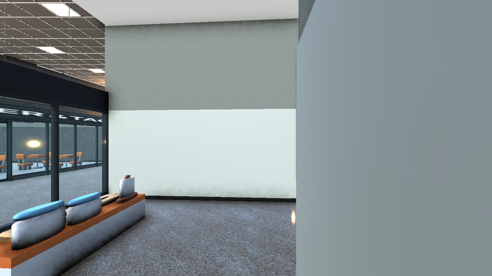
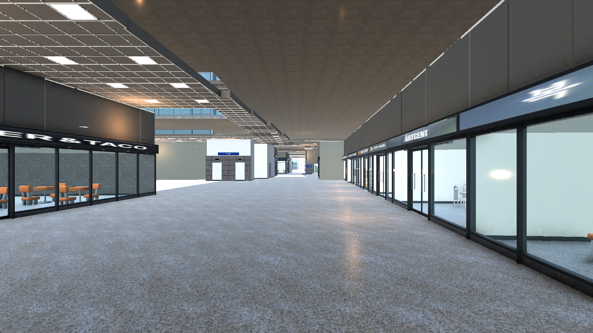
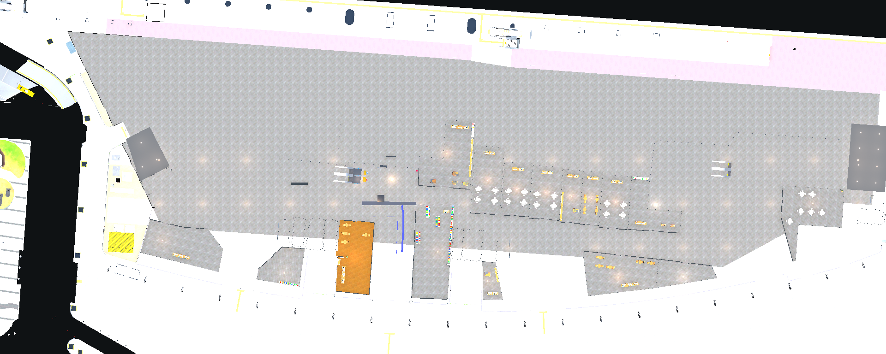
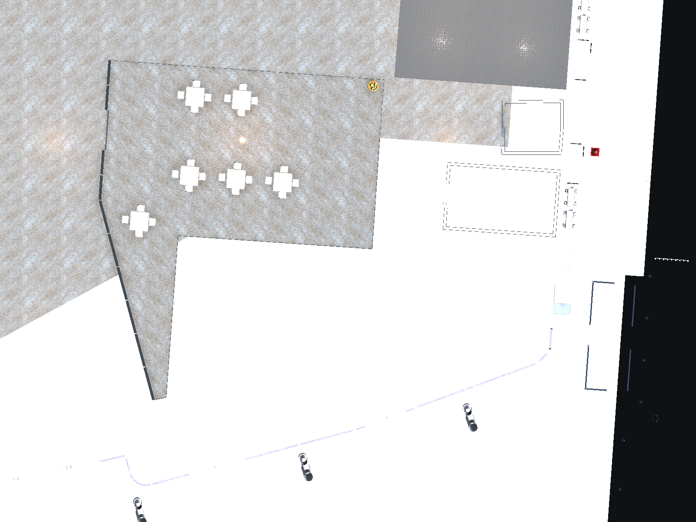
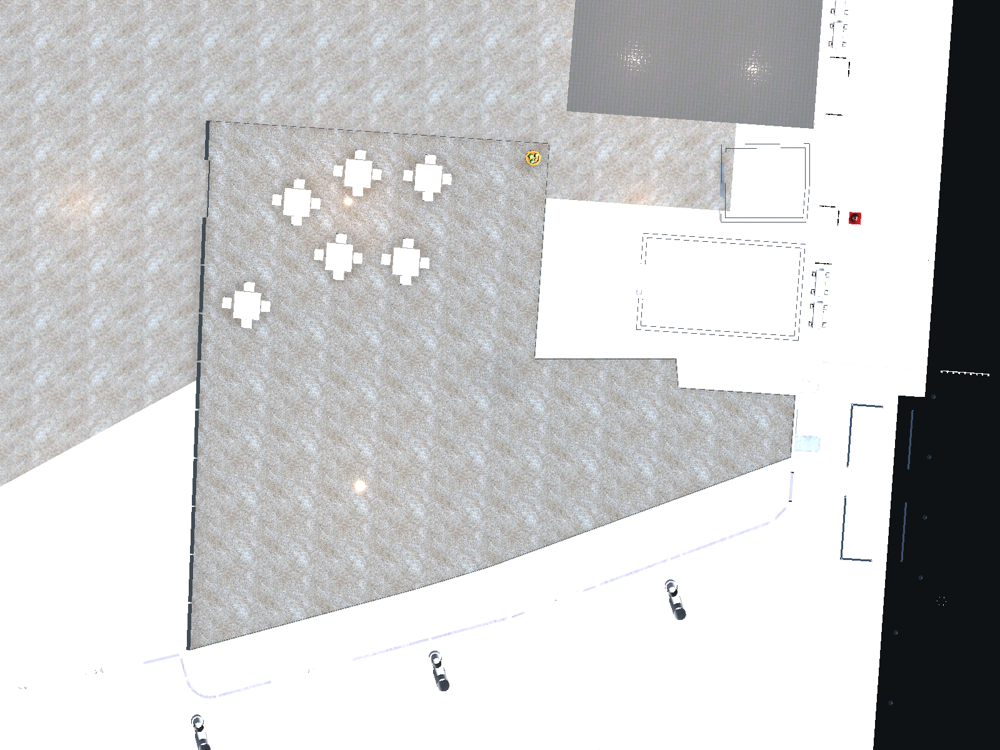
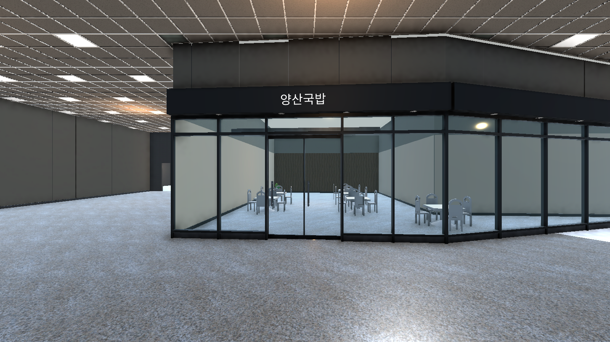
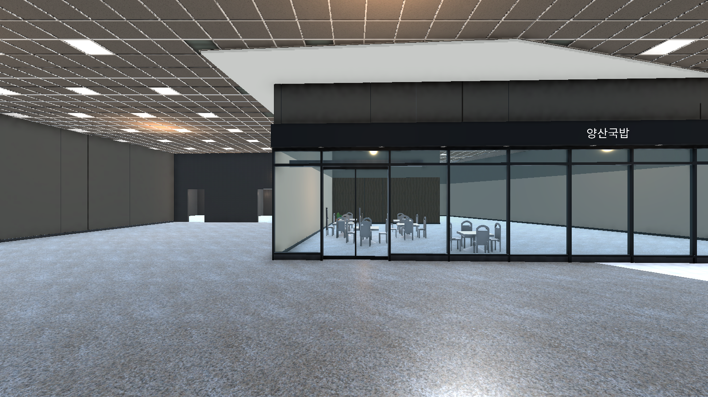
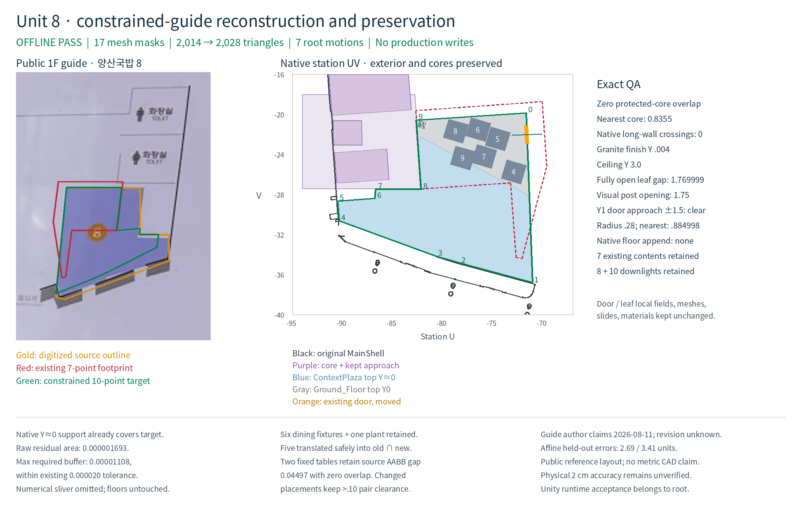
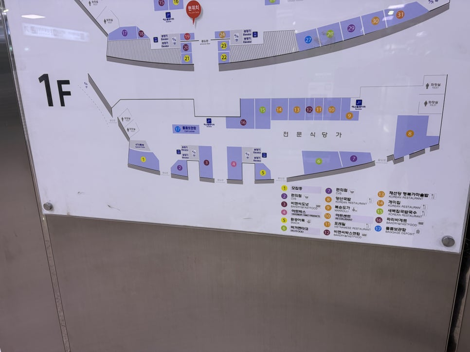

# 부산역 1층 안내도 기준 구조·배치 보정

부산역 현장 안내판의 1층 배치와 현재 씬을 대조해 점포 경계, 공용 통로, 전면 출입구와 내부 마감을 함께 보정했습니다. 결과는 **`Assets/ChooGuard/Scenes/FpsStation.unity`에 저장**했습니다.

기준은 [2026년 8월 게시된 현장 안내판 사진](https://m.blog.naver.com/yoonsscom/224376213780)입니다. 게시자는 2026년 8월 11일 관찰로 설명하며, 인쇄 도면의 개정일은 확인되지 않았습니다. 안내도는 위치·형태·연결 관계의 근거로 사용하고, 기존 건물 외벽과 계단·엘리베이터 코어에 맞춰 등록했습니다.

## 실제로 바뀐 구조

| 구역 | 저장된 수정 |
| --- | --- |
| 뒤쪽 9–16번 전문식당가 | 통로 쪽으로 잘못 이동했던 벽·바닥 마감·천장·전면 유리·프레임·간판·설비·문을 함께 보정했습니다. 보이는 경계와 충돌체를 일치시켰습니다. |
| 14–15번 점포 경계 | 겹치던 모서리를 공통 경계로 연결했습니다. |
| 15–16번 점포 경계 | 파리바게뜨의 꺾인 형태를 보존하면서 옆 점포와 벽 끝점을 연결했습니다. |
| 4번 아트박스 | 광장 쪽 고정 외벽과 기존 출입구를 유지하고 공용 통로 쪽 점포 깊이를 줄였습니다. 천장·전면 유리·조명·문과 진열대를 함께 맞췄습니다. 독립 진열대와 계산대의 크기는 유지했습니다. |
| 8번 양산국밥 | 안내도와 원본 외벽·코어에 맞춰 기존 7개 모서리 경계를 10개 모서리 경계로 재구성했습니다. 벽·천장·바닥 마감·전면 유리·조명·간판과 기존 출입문을 같은 경계에 맞췄습니다. 기존 문짝과 슬라이드 애니메이션은 유지했습니다. |
| 뒤쪽 서비스 구역 | 공용 통로를 가로막던 긴 벽 구간을 짧은 끝벽으로 교체했습니다. 다른 벽 구간은 보존했습니다. |

원본 건물 외관, 화장실과 수직 이동 코어, 기존 구조 바닥은 그대로 유지했습니다. 아트박스에서 확보한 통로와 양산국밥의 새 경계 아래에는 실제 기존 바닥 충돌체가 이어집니다.

## 저장된 Unity 씬의 적용 전후

각 쌍은 같은 카메라 위치와 렌더 설정입니다. 적용 후 이미지는 네 차례 보정이 모두 저장된 최종 씬에서 다시 촬영했습니다.

| 적용 전 | 적용 후 |
| --- | --- |
|  |  |
|  |  |
|  |  |
|  |  |

아래는 적용 전에 검토한 안내도·원본 건축 경계 대조표입니다. 녹색 경계를 최종 씬에 적용했으며, 실제 저장 결과는 위의 Unity 촬영과 아래 검사로 확인했습니다.

## 실제 검증 결과

| 검사 | 결과 |
| --- | --- |
| 저장 씬의 경계·충돌·원본 속성·바닥 지지·재생성 보호 | EditMode 7/7 통과 |
| 이동한 실제 문짝의 열림·통과·슬라이드·닫힘 | 11개 출입문 모두 통과 |
| 새 길찾기 데이터에서 각 출입문 안팎 연결 | 11개 출입문 모두 통과 |
| 원본 생성 경로 재검증 | 점포 24개·전면 19개·공용 3개, 총 46개 원본 묶음 통과 |
| 저장된 객체와 변경 범위 대조 | 객체 문서 26,141개 유지, 선언된 변경 외 차이 0개 |
| 길찾기 | 최종 구조 기준으로 재생성, 실행 검사 통과: 등록된 이용 지점 1,445개 모두 엘리베이터 없이 출구로 연결 |

[검증 요약과 증거 파일](validation.json). 재생성할 때 과거의 벽과 통로가 돌아오지 않도록 적용 경계와 원본 생성 경로를 연결했습니다.

## 자료의 확인 범위

이번 작업은 안내도에서 확인된 구조 불일치를 실제 씬에서 수정한 결과입니다. 앞쪽 1–3·5–7번 점포와 출입구의 존재·순서·큰 연결 관계도 대조했지만, 안내판에 없는 점포 내부 설비의 정확한 위치, 숨은 방 깊이, 문 작동 방식과 실측 치수까지 확정하지는 않았습니다. 현장 공간과 100% 동일하거나 2cm 정확도로 검증됐다는 주장은 하지 않습니다.

최종 씬 SHA256: `fa4dc4be6f5bc09c9b6634b7087c687c6dd2950f04ab749fd6ed90c26b463e80`.
