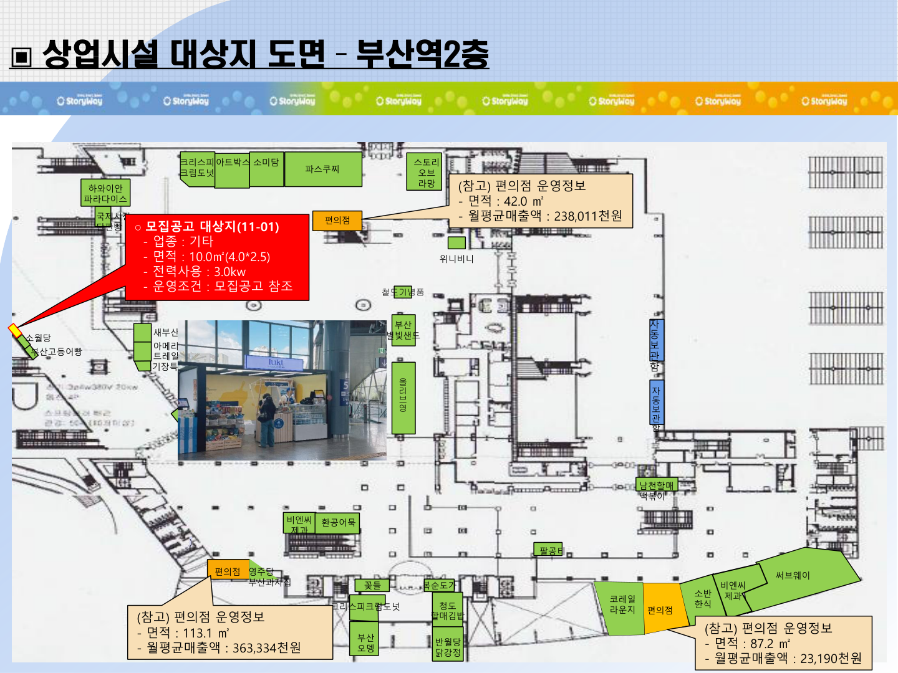

# 부산역 2층 공식 매장 위치도 원본

2026-10-09 Aside CLI 브라우저로 코레일유통 공고와 실제 [붙임3] 첨부를 다시 확인하고 2026-10-07 원본 PDF를 내려받았다. 새 파일 해시는 이전 수집 원본과 동일하다.

| 게시일 | 공식 게시물 | 이 폴더의 원본 | 부산역 쪽 |
| --- | --- | --- | --- |
| 2026-10-07 | [제11차 단기 전문점 모집공고](https://www.korailretail.com/board/boardDetail.do?boardTypeNum=4&boardNum=100083811) | [최신 위치도](부산역_2층_매장위치도_20261007_원본.pdf) | 1쪽. 2쪽 울산역 제외 |
| 2026-03-24 | [제5차 상설 전문점 모집공고](https://www.korailretail.com/board/boardDetail.do?boardTypeNum=4&boardNum=100083333) | [3월 24일 위치도](부산역_2층_매장위치도_20260324_원본.pdf) | 1쪽 |
| 2026-03-11 | [제4차 상설 전문점 모집공고](https://www.korailretail.com/board/boardDetail.do?boardTypeNum=4&boardNum=100083313) | [3월 11일 위치도](부산역_2층_매장위치도_20260311_원본.pdf) | 1쪽. 2쪽 진주역 제외 |

최신 도면에는 새부산약국, 복순도가, 파스쿠찌, 아트박스, 올리브영, 코레일라운지, 편의점, 자동보관함 등 매장명이 표시된다. 3월 공고의 카카오프렌즈·다인명가 표기와 10월 공고의 아트박스·크리스피크림도넛 표기는 다르므로 시점을 섞어 현재 점포명을 결정하지 않는다.

매장 색상 상자와 사진 때문에 가려지는 건축 구조는 PDF에 포함된 원래 배경 JPEG를 그대로 추출한 [원도 배경](부산역_2층_원도배경_원본추출.jpeg)으로 대조한다. 이 배경에 벽·문·계단·기둥 등 상대 배치가 보인다. 원본 배경은 631×496픽셀이며, 확대 렌더는 원래 없는 치수나 세부 구조를 복원하지 않는다.

적용 기준은 이 공식 2층 도면의 위치와 공간 연결 관계다. 공개 매장 위치도를 현재 전체 건물의 실측 CAD나 99% 일치 검증으로 부르지 않는다. 원본·실제 브라우저 응답·SHA는 source-receipt.json 및 연결된 수집 영수증에 보존했다.
