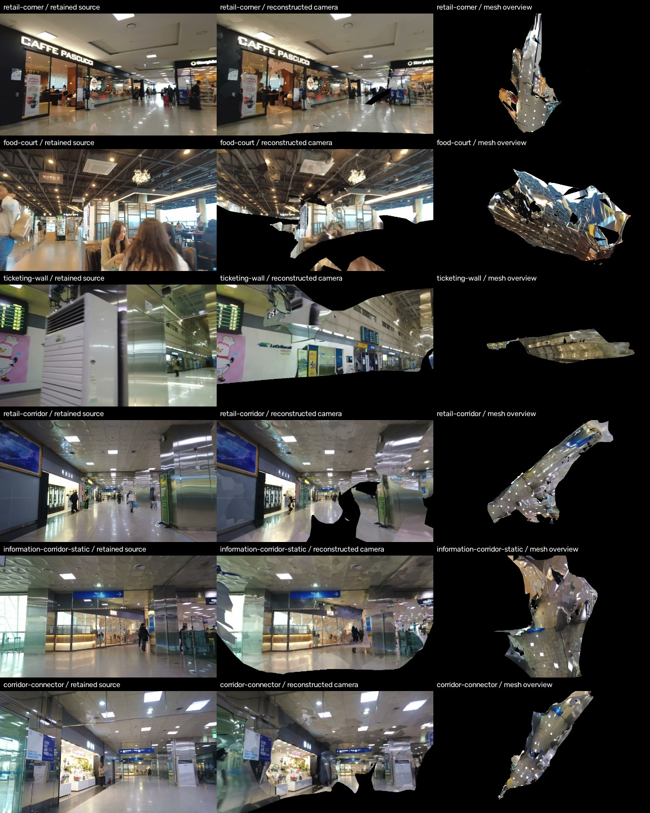

# 부산역 실내 상대 3D 복원 결과

자료 수집 후 실제 카메라 복원·밀집점 생성·삼각 메시·사진 텍스처·Blender 파일까지 생성했습니다. 기존 24프레임 파일럿 밖의 **6개 실내 블록**입니다. 블록별 카메라 관측 합계284개, 같은 JPEG를 중복 제거한 원본 프레임256개, 밀집점 합계471,676개입니다. 사진 관측 없는 균일 UV면5,672개를 제외한 최종 표면 합계는 **621,696삼각형**입니다. 이 합계에는 겹치는 복도 표면이 중복 포함되며 가동 객체 개수나 건물 전체 복원 면적으로 해석하지 않습니다.

원본은 [2023년 업로드 도보 영상](https://www.youtube.com/watch?v=RY2qvE0Tugk)의 보존 클립2개입니다. 촬영일과 미터 축척은 미확인입니다. 모든 산출물에 `reference_only`, `metric_verified:false`, `placement_export_allowed:false`를 유지합니다. 현재 시점의 독립 현장 실측이나2cm 정확도 인증, 생산 씬 배치 완료를 뜻하지 않습니다.

## 실제 복원 파일

| 보이는 실내 구간 | 보존 클립 로컬시간 | 연결 카메라 | 밀집점 | 최종 관측 표면 삼각형 | SfM 재투영 오차 | 편집 파일 |
|---|---:|---:|---:|---:|---:|---|
| 점포 코너·카페 전면 | 68–88s | 40 | 36,643 | 46,580 | 0.592px | [retail-corner.blend](../../workers/twin/output/interior-blocks-20261008/retail-corner/retail-corner.blend) |
| 푸드코트 | 32–58s | 52 | 75,006 | 65,752 | 0.551px | [food-court.blend](../../workers/twin/output/interior-blocks-20261008/food-court/food-court.blend) |
| 발권기벽·안내판 | 238–260s | 44 | 98,459 | 147,727 | 0.487px | [ticketing-wall.blend](../../workers/twin/output/interior-blocks-20261008/ticketing-wall/ticketing-wall.blend) |
| 점포 복도 | 294–320s | 52 | 114,950 | 151,706 | 0.666px | [retail-corridor.blend](../../workers/twin/output/interior-blocks-20261008/retail-corridor/retail-corridor.blend) |
| 정보기둥 복도 | 336–354s | 36 | 51,692 | 75,010 | 0.885px | [information-corridor-static.blend](../../workers/twin/output/interior-blocks-20261008/information-corridor-static/information-corridor-static.blend) |
| 복도 연결 구간 | 312–342s | 60 | 94,926 | 134,921 | 0.632px | [corridor-connector.blend](../../workers/twin/output/interior-blocks-20261008/corridor-connector/corridor-connector.blend) |

첫 점포 블록은 `RY2qvE0Tugk_041-154.webm`, 나머지는 `RY2qvE0Tugk_215-670.webm`의 로컬시간입니다. 다운로드 섹션의 PTS/키프레임 때문에 원영상 타임스탬프와 동일하다고 쓰지 않습니다. 재투영 오차는 이미지 좌표의 적합도이며 미터 오차가 아닙니다.

각 디렉터리의 **`reference_observed_surfaces.obj`**를 최종 OBJ로 사용합니다. 연결 MTL은 `reference_photographic.mtl`, 사진 아틀라스는 `reference_photographic_material_00_map_Kd.jpg`입니다. 원래 MVS기하(`scene_mesh.ply`), 밀집점, 원래 텍스처와 실패 자료도 보존했습니다. Blender 파일은 원래 UV텍스처를 패킹하고 관측 카메라를 포함하며 실제 저장 후 재개방했습니다. 단위는 미확인 상대 단위입니다.

[원영상 관점·실제 복원 렌더·메시 외형 비교](../../workers/twin/evidence/interior-blocks-20261008/source-render-mesh-comparison.jpg)

검은 구역은 가려진/제외된/복원되지 않은 표면입니다. 구조와 점포 전면의 일부는 실제로 복원했지만, 바닥 전체·기기 뒷면·문 경첩·버튼 내부·숨은 방까지 완성한 모델은 아닙니다. 움직이는 사람과 반사 표면의 잔여 흔적, 울퉁불퉁한 기하, 뷰 경계가 있으므로 정밀 가동 부품이나 완성된 충돌 메시로 바로 사용하지 않습니다. 구간별 하단15–28%를 마스킹했습니다.

## 관측이 겹치는 복도 정합

[복도3블록 상대 정합 검토 Blender](../../workers/twin/output/interior-blocks-20261008/relative-corridor-overlap-review.blend)에 점포 복도·연결 구간·정보 복도를 보존된 영상 관측으로 연결했습니다. 각각16개/12개의 **바이트 동일 JPEG**가 공유됩니다. 공유 카메라의 방향과 이동 기준으로 회전·이동·상대 축척을 맞추고 일부 공유 카메라는 계산에서 제외해 비교했습니다.

- 점포 복도→연결구간: 최대 잔차는 공유 카메라 이동 폭의0.364%, 카메라 방향 최대0.230°.
- 정보 복도→연결구간: 최대 잔차는 이동 폭의1.138%, 방향 최대0.363°.

이 값은 같은 영상의 상대 정합 검사이며 독립 물리 검증이 아닙니다. 건물/Unity 실측 좌표계로 등록하지 않았습니다. 검토 파일은3개 메시와148개 관측 카메라를 포함하며, 겹침 표면을 융합하거나 가려진 표면을 생성하지 않았습니다. [정합 계산·공유 프레임 해시](../../workers/twin/evidence/interior-blocks-20261008/corridor-relative-alignment.json), [묶음 재개방 검사](../../workers/twin/evidence/interior-blocks-20261008/corridor-assembly-qa.json).

## 실행과 검사 근거

CPU COLMAP/OpenMVS는 최대2스레드로 블록을 순서대로 처리했습니다. 실제 Blender4.5.9에서6개 파일을 임포트·렌더·저장·재개방했으며 카메라의 광축이 보존된 보정 카메라의 주점과 일치하는지도 계산했습니다. 패킹된 JPEG해시와 보존된 아틀라스해시가 모두 일치하며, 원본영상 해시와 원기하 보존을 확인했습니다. [최종 무결성·렌더 검사](../../workers/twin/evidence/interior-blocks-20261008/artifact-integrity-and-visual-qa.json), [Blender 검사](../../workers/twin/evidence/interior-blocks-20261008/blender-package-qa.json).

`static_region_render_mesh_ray_coverage_fraction`은 특정 카메라에서 마스크 안에 보이는 메시 픽셀 비율입니다. 건물 전체 커버리지나 디지털 트윈 완성률로 사용하지 않습니다. 색 비교도 원본 사진 관점의 차이이며 물리 치수 오차가 아닙니다.

실제 실행에는 세 가지 수정이 필요했습니다.

1. 일부 COLMAP 결과는 완전 연결 모델 외에 그 카메라ID의 부분집합인 작은 초기화 후보도 보존했습니다. 추출 카메라90% 이상을 포함하고 다른 후보카메라를 모두 포함할 때만 **하나의** 완전 모델을 골랐습니다. 다른 좌표계를 합치지 않았습니다.
2. 최초 정보 복도332–354초는 첫8프레임과 나머지36프레임이 실제로 끊어졌습니다. 실패를 유지하고336–354초를 별도로 복원했습니다.
3. 처음 OpenMVS 기본 seam보정/샤프닝 결과는 원색/검은 패치가 생겨 실제 렌더에서 거부했습니다. 같은 원기하를 유지한 채 global/local seam보정과 sharpening을 꺼 원본사진 색으로 재텍스처링했습니다. 환경/수치 원인은 확정하지 않았습니다. 관측 없는 균일UV면은 [OpenMVS 공식 NO_ID패치 규칙](https://github.com/cdcseacave/openMVS/blob/v2.4.0/libs/MVS/SceneTexture.cpp#L2034-L2043)대로 파생 OBJ에서 제외했습니다. 원기하와 최초 실패 렌더는 보존합니다.

[작업기](../../workers/twin/interior_blocks.py)는 `--execute`, `--recover-existing`, `--retexture-photographic`, `--retain-observed-surfaces`, `--align-corridors`를 지원합니다. 결과 디렉터리는 새 이름을 사용해 기존 근거를 덮어쓰지 않습니다. `--block`으로6개 성공 구간을 지정하고 단계별 출력과 실행 영수증을 남깁니다. Blender 패키징/최종검사 스크립트는 [산출 디렉터리](../../workers/twin/output/interior-blocks-20261008/)에 함께 있습니다.

## Unity 편집기 검토용 내보내기

기존6개 관측 표면 Blender를 실제 FBX로 내보냈습니다. **생산 맵 위치에 배치하는 내보내기가 아니라 원래 상대 좌표의 검토용 모델**입니다. FpsSourceAssetImporter가 읽는 모든 정규화 재질 필드를 제공하며 재질명과 사진 아틀라스해시를 실제 FBX와 대조했습니다.

| 블록 | FBX | 정규화 재질 계약 | 관측 표면 삼각형 |
|---|---|---|---:|
| retail-corner | [FBX](../../workers/twin/output/interior-blocks-20261008/retail-corner/unity-export/retail-corner.native-relative.fbx) | [materials.json](../../workers/twin/output/interior-blocks-20261008/retail-corner/unity-export/materials.json) | 46,580 |
| food-court | [FBX](../../workers/twin/output/interior-blocks-20261008/food-court/unity-export/food-court.native-relative.fbx) | [materials.json](../../workers/twin/output/interior-blocks-20261008/food-court/unity-export/materials.json) | 65,752 |
| ticketing-wall | [FBX](../../workers/twin/output/interior-blocks-20261008/ticketing-wall/unity-export/ticketing-wall.native-relative.fbx) | [materials.json](../../workers/twin/output/interior-blocks-20261008/ticketing-wall/unity-export/materials.json) | 147,727 |
| retail-corridor | [FBX](../../workers/twin/output/interior-blocks-20261008/retail-corridor/unity-export/retail-corridor.native-relative.fbx) | [materials.json](../../workers/twin/output/interior-blocks-20261008/retail-corridor/unity-export/materials.json) | 151,706 |
| information-corridor-static | [FBX](../../workers/twin/output/interior-blocks-20261008/information-corridor-static/unity-export/information-corridor-static.native-relative.fbx) | [materials.json](../../workers/twin/output/interior-blocks-20261008/information-corridor-static/unity-export/materials.json) | 75,010 |
| corridor-connector | [FBX](../../workers/twin/output/interior-blocks-20261008/corridor-connector/unity-export/corridor-connector.native-relative.fbx) | [materials.json](../../workers/twin/output/interior-blocks-20261008/corridor-connector/unity-export/materials.json) | 134,921 |

실제 FBX를 Blender의 새 씬에서 다시 읽어6개 모두 면수/정점/UV/재질명/텍스처해시/프레임 표식을 검사했습니다. UV 성분 오차는 모두0이고 좌표 재개방 최대 성분 차이는3.815e-6 **상대 단위**입니다. 이 수치는 포맷 변환 보존 검사이며 현장 미터 정확도가 아닙니다. [FBX 검사 영수증](../../workers/twin/evidence/interior-blocks-20261008/unity-review-export-qa.json).

각 `unity-export/frame-probes.relative.json`은 보정된 원본 중간 카메라 포즈와 투영행렬K를 포함합니다. FBX에 `CG_REF_FRAME_ORIGIN`, `CG_REF_FRAME_X`, `CG_REF_FRAME_Y`, `CG_REF_FRAME_Z` Empty를 넣었습니다. 이4개는 좌표 계약용 표식이며 현장 오브젝트가 아닙니다. Unity 임포트 후 실제4Transform의 위치로 선형축과 원점을 읽으면 FBX 임포터의 좌표변환을 추측하지 않고 카메라 위치/전방/상방을 맞출 수 있습니다. 생산 포즈나 독립 물리 측정 자료로 사용할 수 없습니다.
