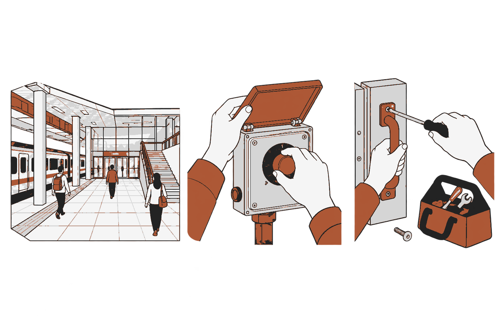

# CHOOGuard

한국철도공사(코레일)의 부산역과 주변 지역을 디지털 트윈으로 구축하는 FPS 비상상황 대응 시뮬레이터

## 1. 제작 취지

구축 대상은 **한국철도공사(코레일)의 부산역과 주변 지역**이다. 현장 사진·영상·도면으로 공간과 객체를 만들고 그 안에서 비상상황 대응을 경험하게 한다.

현실의 비상대응훈련은 인력·장비·공간 운영을 동원해야 하고, 실제 위험을 일으켜 연습하기 어렵다. 준비한 대본과 가용 자원 안에서 진행하므로 재현할 수 있는 상황과 전개의 범위에도 제약이 있다. 이 프로젝트는 현장의 구조·배치·동선을 반영한 디지털 트윈을 구축해 이러한 제약을 줄일 환경을 제안한다.

공간 안의 오브젝트와 사람의 상태에서 가능한 변화가 발생하고, NPC와 플레이어의 개입에 따라 다음 전개가 달라지게 한다. 완성된 사건 대본 하나를 무작위로 선택하는 방식으로 제한하지 않는다. 플레이어는 FPS로 현장을 관찰하고 도구와 설비를 직접 조작하며 상황에 대응한다.

게임의 접근성과 반복 플레이를 통해 비상대응 흐름을 경험하고, 그 경험이 암묵지처럼 축적되어 실제 상황에서도 더 빠르고 정확하게 대응할 수 있기를 기대한다. 접근성·사용성·경험 축적·실제 대응 전이는 서로 다른 평가 대상이며 아직 확인한 효과가 아니다. 사진·영상·도면으로 공간을 구축하고 외형·치수·충돌·통행을 확인한다.

## 2. 개발 요구사항 및 개발 환경

요구사항은 **한국철도공사(코레일)의 부산역과 주변 지역 디지털 트윈 구축**과 **FPS 기반 랜덤 시드 비상상황 시뮬레이터 제작**이다. 맵의 모든 오브젝트·NPC의 상태와 행동을 연결하고 상호작용에서 상황이 생기게 한다. 대응은 부품·도구를 직접 조작하는 방식이며 현실 대응 조작99% 재현을 개발 목표로 둔다.

| 구분 | 환경·요구사항 | 확인할 결과 |
|---|---|---|
| 수집·정합 | 웹 사진·영상·도면, Python, COLMAP / VGGT 비교 | 출처·중복·촬영 구간과 정합 카메라·축척·기준점 |
| 시점 보강 | 3DGS, 생성 보강 후보 | 합성 출처·추가 입력과 미사용 실제 뷰의 비교 |
| 객체 제작 | NeRF·NeuS·2DGS / Hunyuan3D 후보, 실행용 GPU | 시점 표현·표면·생성 형상을 구분한 자산과 비용 |
| 후처리 | Blender | 형상·UV·재질·단위·LOD·충돌 준비 |
| 실행 공간 | Unity 6000.3.23f1, URP 17.3.0 | 기준점 배치·충돌·문·계단·통로 연결 |
| 대응 플레이 | Input System 1.20.0, 1인칭 조작·NPC·사건 기반 | 도구·설비·무전·기관 연결과 상태 변화 |
| 추가 구현 | 생성·판단 모델과 계획 재사용, 시드, OpenXR·XR Interaction Toolkit | 동적 전이·NPC 반응, 머리·양손 입력·공간 UI |

현재 도면·사진을 바탕으로 공간 배치 작업을 진행하고 있으며, 코드에는 1인칭 조작과 NPC·사건의 JEV 판단 연결, 근무 기록이 있다. 모든 객체의 원인·상호작용 연결이나 구축 방법의 성능이 검증됐다는 뜻은 아니다. 3DGS·NeRF 계열·Hunyuan 경로는 입력 조건과 실제 실행 기록을 남기며 비교·검증할 대상이다.

XR 패키지는 현재 설치되지 않았다. 장치 후보는 Meta Quest 3 독립 실행형 Android·OpenXR 빌드이며 접근 가능 여부는 1주차에 확인한다. 시뮬레이터·데스크톱에서 확인한 입력과 실제 HMD의 추적·가독성·성능·불편감을 구분한다. HMD에 접근하지 못하면 해당 검증은 미완료로 남긴다.

## 3. 기술적 특징

### 3.1 현장 자료에서 디지털 트윈을 구축하는 과정

부산역·주변지역의 사진·영상·도면 수집 → 카메라·좌표·축척 정합 → 복원 또는 객체 생성 → Blender 후처리 → Unity 배치와 상태·관계 연결로 진행한다. 부족한 시점은 정합 이후 선택적으로 보강한다.

**입력 수집.** 웹에서 같은 공간과 객체를 설명하는 사진·영상을 모으고 도면과 연결한다. 사진은 외형·재질, 영상은 겹치는 관측과 각도 변화, 도면은 위치·치수·구조 관계의 기준이다. URL·원본 ID·장소·층·촬영 시점·영상 구간·사용 조건을 기록한다. 인접 프레임과 중복 사진을 묶고 서로 다른 시기의 구조를 구분한다. 평가용 촬영 구간은 정합·조건 설정·결과 선택·수동 보정에도 사용하지 않는다.

**카메라·공간 정합.** COLMAP을 기준선으로 두고 VGGT의 기하 추정을 초기화 후보로 비교한다. 사진 사이의 대응점으로 카메라 위치·방향과 장면 구조를 추정하고, 도면 치수와 기준점으로 단위·방향·축척·위치를 맞춘다. 상대 구조의 일치와 실제 미터 단위 정확도를 구분한다. 유리 반사·반복 무늬·관측 부족으로 생긴 실패를 기록하고 독립 기준점으로 확인한다. [R1, R2]

**3DGS 시점 보강.** 정합한 실제 사진과 카메라로 장면을 학습해 다른 위치에서 본 영상을 렌더링한다. 렌더는 같은 관측에서 얻은 합성 결과이며 새로운 현장 관측이 아니다. 기본 3DGS만으로 관측하지 못한 뒷면의 사실을 복구했다고 주장하지 않는다. GS-GS·GIFSplat의 생성 보강은 별도 후보로 비교한다. 실제 입력만 사용한 결과, 3DGS 렌더 추가, 생성 보강을 같은 대상에서 비교하고 미사용 실제 사진·독립 치수로 채택한다. [R3–R5]

**복원과 객체 생성.** 정합된 다중뷰가 있는 대상은 관측 기반 방법을 비교한다. NeRF는 색·밀도를 학습하는 시점 표현이며, 표면이 필요하면 NeuS·2DGS를 별도 복원 후보로 검토한다. 사진이 적은 객체는 Tencent Hunyuan3D로 형상 후보를 만든다. 2.1의 이미지→형상→Paint/PBR과 Omni의 지원 기하 제약→형상 경로를 구분한다. 재질 후처리는 따로 기록한다. 입력·계산량·수동 보정이 다르면 제작 방식의 비교로 해석하며 알고리즘 순위를 일반화하지 않는다. 생성 뒷면·접합부는 실제 자료가 없는 범위를 표시한다. [R6–R10]

**Blender 후처리.** 겹친 면·구멍·법선과 UV·재질을 정리하고 도면 기준 크기·단위·방향·배치 기준점을 맞춘다. LOD와 충돌용 형상을 준비한다. 수동으로 바꾼 부분과 보정 시간·자산 크기·실행 비용을 남긴다.

**Unity 배치·연결.** 도면과 기준점에 맞춰 자산을 배치한다. 외형·충돌·NPC 통행을 분리해 문·계단·통로의 통과와 막힘을 검사한다. 실제 사진·독립 치수와 대조하고 오브젝트 ID·종류·현재 상태·인접·설비 연결을 등록한다. 외형이 있다는 사실만으로 사건 원인이나 조작 대상으로 동작하지는 않는다. 사진 일치·도면 일치·실측 정확도를 구분해 보고한다.

### 3.2 모든 오브젝트·NPC에서 상황과 행동 생성

완전 랜덤 오픈월드를 개발 목표로 둔다. 맵 전체 오브젝트와 NPC의 상태·관계·행동을 연결하고, 상호작용의 결과에서 다음 상황이 생기게 한다. 물리와 실행 가능한 조작은 코드가 처리한다. 개발자가 작성한 완성 사건 목록을 추첨하는 방식으로 범위를 제한하지 않는다.

**생성·판단·실행.** 생성 모델은 세계 상태와 목표에서 행동의 조합을 제안하고, 실제 객체 ID와 가능한 조작에 연결한다. JEV는 제안한 선택과 변화의 정도를 평가한다. 실행 전 대상·상태·경로를 검사한 뒤 Unity에서 적용하고 결과를 다음 판단에 반영한다. SimWorld와 Virtual Community의 상태·목표·행동·실행 피드백 구조를 적용한 개발안이다. 두 연구는 각각 Unreal Engine과 Genesis를 사용하므로 Unity 연결은 별도 구현한다. 해당 실험은 역 비상상황의 정합성이나 무제한 행동 생성을 증명하지 않는다. [R24, R28]

JEV의 공식 API는 Choice·Score·Noul로 주어진 후보나 기준을 평가한다. 따라서 **JEV는 판단, 별도 생성 모델은 계획 제안**에 사용한다. 형식이 맞는 응답도 사실·물리 검사를 거쳐야 한다. 지원하지 않는 행동은 실행하지 않고 기록한다. 기존 코드가 열거하는 사건 원인·전개와 전체 객체 상호작용을 만드는 개발 목표는 구분한다. [R29]

**전체 객체와 NPC 관측.** 모든 객체를 위치·상태·관계·가능한 행동으로 등록한다. 부품 메시와 상위 물리 객체의 ID를 함께 유지해 메시 분할이 사건 빈도를 늘리지 않게 한다. NPC는 자신이 관측한 정보와 기억·목표를 사용한다. 모델에는 판단에 관련된 상태 변화와 의존 관계를 검색해 전달하고, 나머지 객체도 세계 목록에 유지한다. 정보가 부족하면 추가 조회한다. AutoGPT+P의 객체별 가능한 행동을 이 연결에 참고한다. [R20]

**계획 재사용과 비용.** 유효한 계획은 저장해 재사용하고 새 목표·상태 변화·행동 실패·선행 조건 변경 때 다시 호출한다. AgenticCache는 계획 재사용과 비동기 갱신, ADaPT는 실행이 어려울 때 계획을 분해하는 근거다. 본 게임의 토큰 절감률은 측정 전이다. 캐시에는 관련 객체와 상태 버전을 저장하고 조건이 바뀌면 무효화한다. 요청·토큰·동시 처리 상한, 기한과 오래된 응답의 폐기를 두며 기다리는 동안 유효한 이동·물리 실행을 계속한다. [R25, R26]

**NPC 이동.** 목적지와 행동을 고르는 판단, 경로 탐색, 주변 회피와 보행을 나눈다. 위험을 보거나 경보·지시로 알게 되면 위치와 목표에 맞게 반응한다. RESCUE의 인지·판단·운동 분리를 참고한다. NavMesh를 이동 기반으로 두고 ORCA 또는 social force를 회피 비교에 사용한다. [R11–R14, R19]

**시드와 재생.** 시드는 무작위 변화의 출발값이다. 난수 흐름과 후보 순서, 알고리즘·공간·자산 버전, 초기 상태·입력·모델 응답과 적용 틱을 저장한다. 같은 기록을 재생할 때는 모델을 다시 호출하지 않는다. 같은 시드라도 입력과 모델 응답이 다르면 전개가 달라질 수 있다. [R15, R16]

호출을 반복하는 모델 정책과 계획을 재사용하는 정책을 같은 세계·입력·예산에서 비교한다. 객체·목표의 미사용 조합에서 상태 변화의 연쇄, 행동 타당성·완료, 토큰·지연과 실패를 측정한다. 전체 객체의 연결 범위도 함께 보고한다. 상세 조건은 [시뮬레이터 설계안](SEEDED_SIMULATION_DESIGN.md)과 [평가 계획](EVALUATION_PROTOCOL.md)에 정리했다.

### 3.3 부품·도구를 직접 조작하는 FPS·VR

마이 썸머 카처럼 오브젝트의 부품과 도구를 직접 다루는 방식으로 개발한다. 플레이어가1인칭으로 부품을 잡고 돌리거나 누르고, 도구를 사용해 결합·분리한다. 현실 장비의 구조·회전축·이동 범위·접촉·도구 호환·잠금·조작 순서·작동 조건과 실패 결과를 재현한다. 이 조작의 복잡성을 대응 경험에 포함한다.

Blender에서 부품과 축·원점을 나누고 Unity에서 관절·충돌·물리와 상태를 연결한다. HingeJoint·ConfigurableJoint로 움직이는 축과 범위를 설정하고, FPS 입력과 VR의 머리·양손 추적·잡기를 같은 객체 상태에 연결한다. 물리와 플레이어 조작은 로컬 실행이 맡고 모델은 상황·NPC 판단을 맡는다. 조작이 바꾼 세계 상태는 다음 전개에 반영한다. [R30, R31]

**현실 대응 조작99% 재현은 개발 요구사항**이다. 장비별 부품·도구·순서·조건·결과와 출처를 평가 전에 고정한다. 미확인·미구현 항목도 남기고 치수·움직임·시간·힘·피드백을 나눠 대조한다. 항목 일치율만으로 물리·체감 전체가99% 같다고 단정하지 않는다. 조작 결과를 좌우하는 필수 조건은 모두 통과해야 하며, 판정할 전체 범위와 기준이 정해지기 전에는99% 달성으로 보고하지 않는다. [현실 조작 재현 계획](INTERACTION_FIDELITY.md)

## 4. 주단위 구현계획

| 주차 | 작업 | 산출물 |
|---|---|---|
| 1주 | 부산역·주변지역 범위와 자료·출처·현재 구현, 장치·평가 기준 확인 | 입력 목록·요구·평가표 |
| 2주 | 카메라·축척·좌표 정합, 시점 보강 비교 | 정합 결과·보강 비교표 |
| 3주 | 복원·생성 비교, Blender 후처리 | 비교 자산·비용·보정 기록 |
| 4주 | Unity 배치·충돌·통행, 부품·도구·관절·상태 연결 | 공간·객체 연결표 |
| 5주 | 생성·판단·계획 재사용·시드, NPC·FPS·VR 입력 통합 | 동적 실행 빌드·기록 |
| 6주 | 공간·비용·행동·사용성 평가, 수정과 시연 | 최종 빌드·영상·평가 |

기존 배치·FPS 기반을 활용해 병행한다. 연결된 객체·전이·조작과 미완료 범위를 주별로 기록하며 전체 맵의 객체 등록 수와 행동 연결 범위를 확인한다.

## 5. 결과물 형상

그림1. 부산역과 주변 지역을 구축할 공간 표현과 부품·도구 직접 조작의 예. 생성 개념도이며 실제 부산역 형상·실행 화면·정확도의 증거는 아니다.

플레이 화면은 현장 시야·상호작용 대상·장비와 NPC 행동·상황 전개를 연결한다. 관찰한 정보와 무전으로 받은 정보, 확정·미확인 상태를 구분한다. 제출물은 실행 빌드, 실제 플레이 시연 영상, 생성·판단·실행 기록과 평가 자료다. 시연 영상은 결과물 형상 장에서 제시한다.

## 6. 기대효과

| 기대효과 | 확인할 근거 |
|---|---|
| 공간을 다시 활용하며 현실 훈련의 자원 부담을 줄일 가능성 | 공간 제작·갱신·재사용 비용, 동일 목적의 훈련 자원 비교. 단순히 가상공간이라는 이유로 저렴하다고 확정하지 않는다. |
| 다양한 조건과 전개의 반복 경험 | 원자 전이·NPC 반응의 타당성과 다양성, 접근·조작·사용성과 불편감, 반복 모델 호출 대비 토큰·지연·실패·로컬 CPU |
| 대응 흐름이 경험으로 축적되고 실제 대응이 빨라질 가능성 | 사전·사후·지연 측정, 새로운 상황과 안전한 현장 과제로의 전이, 행동 시간·절차 오류·중단·유지 |

VR 안전교육의 지식·유지와 가상/현실 과제의 전이를 다룬 연구는 평가 설계의 근거다. 본 게임의 암묵지·실제 대응 속도·정확도 향상을 입증하지 않는다. 반복 플레이나 공간 외형의 충실도만으로 교육 효과를 단정하지 않는다. [R22, R23]

공간은 미사용 실제 사진·독립 치수로 검증하고, 사건·NPC는 단독 교체와 통합 비교를 나눈다. 객체·시나리오·참가자를 평가 단위로 두며 인접 프레임이나 반복 호출을 독립 표본으로 늘리지 않는다. 비교 예산·주 지표·허용 오차를 먼저 정하고 차이·신뢰구간·실패 수를 보고한다. 자세한 조건은 [평가 계획](EVALUATION_PROTOCOL.md)에 정리했다.

### 참고문헌

- **R1.** Schönberger & Frahm. [Structure-from-Motion Revisited](https://openaccess.thecvf.com/content_cvpr_2016/html/Schonberger_Structure-From-Motion_Revisited_CVPR_2016_paper.html). CVPR, 2016.
- **R2.** Wang et al. [VGGT: Visual Geometry Grounded Transformer](https://openaccess.thecvf.com/content/CVPR2025/html/Wang_VGGT_Visual_Geometry_Grounded_Transformer_CVPR_2025_paper.html). CVPR, 2025.
- **R3.** Kerbl et al. [3D Gaussian Splatting for Real-Time Radiance Field Rendering](https://doi.org/10.1145/3592433). ACM TOG / SIGGRAPH, 2023.
- **R4.** Kong, Yang & Wang. [Generative Sparse-View Gaussian Splatting](https://openaccess.thecvf.com/content/CVPR2025/html/Kong_Generative_Sparse-View_Gaussian_Splatting_CVPR_2025_paper.html). CVPR, 2025.
- **R5.** Chen et al. [GIFSplat: Generative Prior-Guided Iterative Feed-Forward 3D Gaussian Splatting from Sparse Views](https://arxiv.org/abs/2602.22571). CVPR, 2026; arXiv author manuscript.
- **R6.** Mildenhall et al. [NeRF: Representing Scenes as Neural Radiance Fields for View Synthesis](https://www.matthewtancik.com/nerf). ECCV, 2020.
- **R7.** Wang et al. [NeuS: Learning Neural Implicit Surfaces by Volume Rendering for Multi-view Reconstruction](https://proceedings.nips.cc/paper/2021/hash/e41e164f7485ec4a28741a2d0ea41c74-Abstract.html). NeurIPS, 2021.
- **R8.** Huang et al. [2D Gaussian Splatting for Geometrically Accurate Radiance Fields](https://surfsplatting.github.io/). SIGGRAPH Conference Papers, 2024.
- **R9.** Team Hunyuan3D. [Hunyuan3D 2.1: From Images to High-Fidelity 3D Assets with Production-Ready PBR Material](https://arxiv.org/abs/2506.15442). arXiv technical report, 2025.
- **R10.** Team Hunyuan3D. [Hunyuan3D-Omni: A Unified Framework for Controllable Generation of 3D Assets](https://arxiv.org/abs/2509.21245). arXiv technical report, 2025.
- **R11.** van den Berg et al. [Reciprocal n-body collision avoidance](https://gamma-web.iacs.umd.edu/ORCA/). Robotics Research / ISRR, 2011.
- **R12.** Helbing & Molnár. [Social force model for pedestrian dynamics](https://journals.aps.org/pre/abstract/10.1103/PhysRevE.51.4282). Physical Review E, 1995.
- **R13.** [Demonstrating Arena 5.0: A Photorealistic ROS2 Simulation Framework for Developing and Benchmarking Social Navigation](https://roboticsproceedings.org/rss21/p092.html). RSS, 2025.
- **R14.** Kunchi et al. [PeopleFlow: a reproducible geometry-aware multi-agent framework for evacuation safety evaluation across diversified building environments](https://www.frontiersin.org/journals/built-environment/articles/10.3389/fbuil.2026.1850477/full). Frontiers in Built Environment, 2026. 2D 및 단순화된 행동 가정의 한계를 가진 연구 사례.
- **R15.** Unity Technologies. [ECS Galaxy Sample — Determinism Overview](https://github.com/Unity-Technologies/ECSGalaxySample/blob/main/_Documentation/determinism.md). 공식 구현 문서, 2026-10-13 확인. 본 프로젝트의 결정론을 증명하는 자료는 아님.
- **R16.** Cobbe et al. [Leveraging Procedural Generation to Benchmark Reinforcement Learning](https://proceedings.mlr.press/v119/cobbe20a.html). ICML / PMLR 119, 2020.

- **R17.** Munje et al. [SocialNav-SUB: Benchmarking VLMs for Scene Understanding in Social Robot Navigation](https://proceedings.mlr.press/v305/munje25a.html). CoRL / PMLR 305:1120–1143, 2025. 공통 입력·외부 판정의 설계 근거이며 JEV나 역무 대응의 검증 결과가 아니다.
- **R18.** Vin et al. [3D Environment Modeling for Falsification and Beyond with Scenic 3.0](https://people.eecs.berkeley.edu/~sseshia/pubs/b2hd-vin-cav23.html). CAV, 2023. [CVPR 2024 공식 튜토리얼](https://scenic-lang.org/cvpr24/)은 별도 교육 자료다.
- **R19.** Liu et al. [RESCUE: Crowd Evacuation Simulation via Controlling SDM-United Characters](https://cic.tju.edu.cn/faculty/likun/projects/RESCUE/). ICCV, 2025. [저자 원문](https://arxiv.org/html/2507.20117v2).
- **R20.** Birr et al. [AutoGPT+P: Affordance-based Task Planning using Large Language Models](https://roboticsproceedings.org/rss20/p112.html). RSS, 2024. DOI 10.15607/RSS.2024.XX.112.
- **R21.** Raistrick et al. [Infinigen Indoors: Photorealistic Indoor Scenes using Procedural Generation](https://arxiv.org/html/2406.11824v1). CVPR, 2024.

- **R22.** Stefan et al. [How effective is virtual reality for electrical safety training? Evaluating trainees’ reactions, learning, and training duration](https://doi.org/10.1016/j.jsr.2024.06.002). Journal of Safety Research 90:48–61, 2024. 지식의 사전·사후·유지 평가이며 본 게임의 실제 대응 효과를 검증한 연구가 아니다.
- **R23.** Narciso et al. [Assessing the perceptual equivalence of a firefighting training exercise across virtual and real environments](https://doi.org/10.1007/s10055-023-00917-6). Virtual Reality 28:14, 2024. 소규모 가상/현실 과제 비교이며 전이 결과의 한계를 포함한다.

- **R24.** Ye et al. [SimWorld: An Open-ended Simulator for Agents in Physical and Social Worlds](https://proceedings.nips.cc/paper_files/paper/2025/hash/f1eff44d59d9c66cc6e359d36d80b0b9-Abstract-Conference.html). NeurIPS, 2025. DOI10.52202/085713-5519. Unreal Engine5에서 모델의 행동과 세계 피드백 연결. Unity·역 비상 대응의 검증이 아니다.
- **R25.** Kim, Wu & Tambe. [AgenticCache: Cache-Driven Asynchronous Planning for Embodied AI Agents](https://proceedings.mlsys.org/paper_files/paper/2026/hash/c66a9db149261435664284a20b6f1d42-Abstract-Conference.html). MLSys8, 2026. 계획 재사용과 비동기 갱신. 본 게임의 비용 절감률은 별도 측정한다.
- **R26.** Prasad et al. [ADaPT: As-Needed Decomposition and Planning with Language Models](https://aclanthology.org/2024.findings-naacl.264/). Findings of NAACL, pp4226–4252, 2024. DOI10.18653/v1/2024.findings-naacl.264. 실행 실패에 따른 계획 분해. 매 프레임 판단을 없애는 Unity 도구는 아니다.
- **R27.** Wang et al. [Voyager: An Open-Ended Embodied Agent with Large Language Models](https://voyager.minedojo.org/). 2023 저자 공개 원문. 실행 가능한 기술의 저장·조합과 환경 피드백. Minecraft 결과를 역의 상황 생성 성능으로 옮기지 않는다.
- **R28.** [Virtual Community: An Open World for Humans, Robots, and Society](https://virtual-community-ai.github.io/). ICLR, 2026. [저자 원문](https://virtual-community-ai.github.io/paper.pdf). 공간에 연결된 목표·사회 관계와 행동 계획. 선택한 행동 범위·물리 연결의 한계가 있다.
- **R29.** TypeSafe. [Introduction](https://docs.typesafe.ai/introduction), [API reference](https://docs.typesafe.ai/api). 공식 제품 문서, 2026-10-13 확인. 후보·기준의 구조화 판단과 모델·사용량 응답. 학술논문이나 현장 행동 검증이 아니다.

- **R30.** Amistech Games. [My Summer Car 공식 제품 페이지](https://store.steampowered.com/app/516750/My_Summer_Car/). 사용자가 지정한 부품 조작 참고게임. 학술자료나 현장 조작 재현율의 검증 자료가 아니다.
- **R31.** Unity. [HingeJoint](https://docs.unity3d.com/6000.0/Documentation/Manual/class-HingeJoint.html), [ConfigurableJoint](https://docs.unity3d.com/6000.0/Documentation/Manual/class-ConfigurableJoint.html), [XR Interaction Toolkit3.3](https://docs.unity3d.com/Packages/com.unity.xr.interaction.toolkit@3.3/manual/index.html). 공식 구현 문서,2026-10-13 확인. 부품 관절·잡기의 기반이며 장비 조작의99% 재현을 보장하지 않는다.
