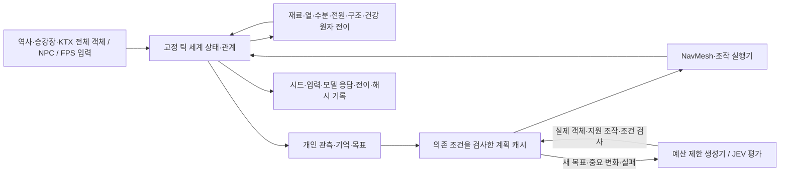

# 부산역 전체 오브젝트 기반 시드 FPS 대응 시뮬레이터

현재 저장된 역사·승강장·KTX 전체 형상을 **별도 Unity 프로젝트**로 가져온다. 역사 건축 작업 세션과 독립적으로 실행한다. 원래 `Assets`, 씬, NavMesh, 공식 객체와 역사 내부 쓰기 권한은 변경하지 않는다. 실행용 자원은 현재 프로젝트의 원본·재질·텍스처를 복사하고 출처 해시를 남긴다.

## 구조



완성 사건 목록이나 시나리오 ID를 추첨하지 않는다. 동일 객체라도 전원 연결·수분·단열·열·근접 객체·NPC 이동·개입에 따라 가능한 변화가 달라진다. 여러 원인은 동시에 전개될 수 있고, 아무 비상상황도 발생하지 않는 실행도 허용한다. 자연재해·의료·고장·군중·민방위 경보는 구현한 물리/행동 의미의 범위에서 연결된다. 무한한 실제 현상이나 미등록 객체의 의미가 자동으로 구현된다는 뜻은 아니다.

`Core`는 Unity와 API 없이 실행되는 세계 커널이다. `Planning`은 생성·평가·계획 재사용과 실행 계약이고, `Unity`는 FPS·물리·경로·시각화 어댑터다. 로컬 실행은 중단 없이 유지하며 생성 모델과 JEV는 새로운 판단이 필요한 때에만 사용할 수 있다. 호출 0은 비교용 기준선이며 생성 기능 전체의 대체 목표가 아니다.

## 빠른 검증

저장소 루트에서 실행한다. 이 명령은 열려 있는 Unity에 접근하지 않는다.

개발용 `SimulatorCli`의 `kind=header` baseline JSONL과 native FPS의 `RunHeader/Tick` exact tape는 별개 형식이다. CLI 기록은 제품 native reader가 소비하지 않으며, 고정 fixture 재생 PASS가 임의 외부 float64 입력의 exactness를 보증하지 않는다. native 전체 DTO·내부 planning-record-v3 응답의 정확한 숫자 계약은 `docs/EMERGENCY_CAUSAL_ARCHITECTURE.md`를 따른다.

```bash
python3 workers/simulator/run_checks.py test
python3 workers/simulator/run_checks.py run --seed 20261013 --ticks 1200 --output output/simulator/checks/run.jsonl
python3 workers/simulator/run_checks.py replay --input output/simulator/checks/run.jsonl
python3 workers/simulator/run_checks.py benchmark --seed 20261013 --ticks 1200 --output output/simulator/checks/benchmark.json
```

플레이어 개입과 미지원 조작의 거부도 기록·재시뮬레이션한다. 아래 입력 파일은 검증을 위한 조작 테이프이며 비상사건의 대본이 아니다.

```bash
python3 workers/simulator/run_checks.py run --seed 20261013 --ticks 180 --input workers/simulator/data/intervention-inputs.jsonl --output output/simulator/checks/interventions-current.jsonl
python3 workers/simulator/run_checks.py replay --input output/simulator/checks/interventions-current.jsonl
```

Unity에 포함된 Mono/C# 컴파일러를 사용한다. 다른 설치 위치에서는 `CHOOGUARD_MONO_ROOT`로 `MonoBleedingEdge` 디렉터리를 지정한다. `Newtonsoft.Json.dll`은 현재 프로젝트의 패키지 캐시에서 읽는다.

## 별도 Unity 실행

```bash
python3 workers/simulator/stage_unity.py --world-snapshot output/simulator/world-snapshot/ec2f5f3b6097bcc7
```

스테이징 결과는 `output/simulator/platform-ktx-unity`다. **이 경로를 별도 프로젝트로 열어 실행한다.** `Open-Simulator.command`는 현재 정본과 지문이 일치하는 standalone이 있으면 이를 실행하고, 없으면 별도 편집기를 연다. 기존 CHOOGuard 편집기의 Main/역사 내부 씬에서 빌더나 NavMesh 재생성을 실행하지 않는다. 원본과 복사본의 SHA-256, 좌표 변환과 재질 연결은 별도 프로젝트의 `STAGING-RECEIPT.json` 및 `Assets/Simulator/Resources/SourceManifest.json`에 기록한다.

생성된 FPS의 실행·조작과 실제 Unity 검사 결과는 [검증 결과](VALIDATION.md)에 기록한다.

일반 macOS 데스크톱에서 [Open-Simulator.command](Open-Simulator.command)를 실행하면 독립 Unity 프로젝트와 개발·운영용 로컬 로그인 도우미를 함께 연다. 깨끗한 설치에서는 먼저 [인증 도우미 의존성](provider_auth/README.md)을 설치한다. 현재 자동화 환경의 macOS LaunchServices 오류 때문에 그래픽 실행은 별도로 확인해야 한다.

## 부품 조작과 대응 절차

대외비 매뉴얼은 구현의 선행 조건이 아니다. 사용자가 허용한 추론을 `INFERRED_TRAINING`으로 표시하고, 공개 원칙·현재 형상·객체 관계를 기반으로 조작과 대응 규칙을 구성한다. 실제 코레일 승인 절차나 현장 수치로 표현하지 않는다.

- 마우스 왼쪽으로 부품을 잡고, 드래그·휠로 연속 조작한다. Shift는 반대 방향, F/G는 운반·놓기, Tab은 공구 선택, C/T는 점검·태그, V/B는 연결·분리다. 선택한 공구도 실제로 집어 들어야 한다.
- 잠금·맞는 열쇠·걸쇠·이동 한계·마찰·끼임·신체 간섭·부분 이동·전원·소모량을 각각 검사한다. 소화기는 핀·노즐·레버·남은 약제와 실제 조준이 연결된다. 차단기는 덮개·스위치·점검기·태그 순서와 재가동 잠금을 갖는다.
- 대응 패널에서 관측 → 보고/지원 요청 → 수신 확인·복창 → 역할에 맞는 실행 → 현장 확인·인계 과정을 진행한다. 통신 전송이 곧 전달이나 작업 완료가 되지 않는다. 대피는 실제 경로·몸체 통과·이동과 도착을 확인한다.
- 대응 역할은 승객·역무·승무·관제·시설·소방·의료로 구분한다. 로컬 훈련 참여자는 화면에서 역할별로 조작할 수 있다. 다른 사람에게 실제 메시지를 보내지 않는다.

[장비 조작 계약](MECHANICAL-INTERACTIONS.md), [대응 추론 근거](docs/RESPONSE_INFERENCE.md), [역사 설비·재료 가정](docs/STATION_CAPABILITY_INFERENCE.md)에 상세 범위와 실패 조건을 기록한다. 현재 전체 형상에 등록되는 원본 객체는4,115개이며 기존532개 훈련 상태와 별도로396개 역사 의미·공급망 상태를 연결한다. 역사 이동 지점과 훈련 팀·도구 등은 추가 상태다. 전체 등록과 모든 부품의 조작 가능 여부는 구분한다. 미지원2,400개 원본의 의미는 명시적으로 남기며, 52개 역사 문은 현재 수동 장벽 상태로만 연결한다. 검증된 KTX 출입문7곳과 객실문2곳의 움직임을 역사 문에 복제하지 않는다.

## 사용자 구독으로 AI 초기 조건 만들기

제품의 계정·모델 화면은 기존 FPS 디자인을 계승한 **Unity uGUI/TMP** 메뉴다. 여러 provider·계정의 로그인 상태와 계정별 모델 합집합을 표시하고, 플레이 전체에 사용할 모델 하나와 구독 사용·초기 생성 1회 허용을 명시적으로 선택한다. 브라우저는 provider OAuth 로그인에만 사용하며, 로컬 HTML은 개발·운영 진단 도구다. [Native UI 적용·검증 상태](docs/native-provider-ui.md)에 소스 계약과 배포 증거를 기록했다. helper native API는 적용됐으며 원본 Unity 통합·한국어 폰트 연결·실제 화면과 입력 검증은 사용자 보류에 따라 남아 있다.

기존 ChatGPT 운영·진단 도우미에서는 **Continue with ChatGPT**로 로그인하고 해당 계정 모델과 1회 사용 허용을 설정할 수 있다. 이 절차는 이전 연결 검증용이며, 제품 메뉴에서는 **AI 계정과 모델 · F8**의 native 컨트롤로 연결·선택·동의를 처리한 뒤 사용자가 월드 생성과 훈련 시작을 직접 실행한다.

AI에는 모든 등록 객체·NPC의 상태·관계·지원 조작과 시드에서 얻은 잠재값을 보낸다. AI는 젖음·단열·냉각·설비 마모·환경 입력 등 지원되는 상류 조건만 제안한다. 발화·부상·고장 같은 결과나 시나리오 ID를 직접 넣을 수 없다. 조건을 검증한 후 기존 인과 커널이 이후 상황을 전개한다. 부적절하거나 오래된 응답은 세계를 변경하지 않는다. 아무 비상상황도 생기지 않는 실행도 허용한다.

OAuth 토큰은 Unity·원본 자원·재생 테이프에 넣지 않는다. 사용자의 계정별 비공개 저장소에서 관리하고, Unity에는 일시적인 로컬 연결 권한만 전달한다. 구독 연결이 거부되거나 사용 한도에 도달하면 API 키 과금으로 전환하지 않는다. 다른 계정·모델로 전환하면 이전 연결의 요청을 거부한다. 사용자 브라우저 로그인과 구독 모델1회 추론은 이미 완료됐다. 기존 승강장/KTX 요청에서 입력36,145·출력53토큰을 사용했고 빈 변경안을 정상 수락했다. 새 전체 월드 구현을 검증하기 위해 추가 구독 호출을 하지 않는다.

일반 NPC 계획 예산과 초기 세계 생성 예산은 분리했다. 초기 생성은 사용자 허용 후 1회이며 기본 최대192,000입력 예약 단위·2,048출력 토큰, 시뮬레이터 생성기는 실제 요청 출력을512토큰으로 제한한다. 입력 예약 단위는 UTF-8 바이트 등을 사용하는 보수적인 추정치다. 반복 식별자·공통 상태·수치 열을 복원 가능한 형식으로 압축하며 객체·부모·관계·상태·시각 매핑은 모두 유지한다. 실제 공급사 토큰 사용량은 예약 추정치와 구분한다. 초기 요청에서 객체를 몰래 제외하지 않으며 이후 매 틱마다 모델을 호출하지 않는다. NPC의 새로운 판단은 별도 예산·캐시로 처리한다.

압축 전후 실제 로컬 토크나이저 검증에서도 모든 객체가 유지되는지 확인한다. 준비된 Qwen 로컬 모델은 전체 월드 문맥 한도가 부족하므로 전체 입력을 잘라 보내지 않는다. 로컬 모델은 작은 개인 관측의 계획·캐시에 사용하고, 초기 월드 전체 생성은 사용자가 선택한 구독 모델에 명시적으로 한 번 요청한다.

현재 구독 연동은 공식 [Sign in with ChatGPT](https://developers.openai.com/siwc/token-sharing-open-source/sign-in)와 공개 Responses API를 사용한다. OMP·pi의 계정 선택·갱신 구조는 참고했으며 그 도구의 클라이언트 ID나 기존 로그인 토큰을 가져오지 않는다. Claude.ai 로그인 중계는 현재 [공식 인증 제한](https://code.claude.com/docs/en/legal-and-compliance#authentication-and-credential-use)에 따라 제공하지 않는다.

다음 환경 변수와 API 설정은 엔진 없는 개발·진단 도구용이다. 제품 Unity 런타임은 사용자가 native 메뉴에서 확정한 구독 계정·모델을 초기 생성과 NPC 계획에 함께 사용한다. 개발용 로컬 생성 서버를 별도로 실행할 때 아래 주소는 로컬 API 예이며 모델 이름은 설치된 모델을 지정한다.

```bash
export CHOOGUARD_ENABLE_MODELS=1
export CHOOGUARD_PLANNER_ENDPOINT=http://localhost:11434/v1/chat/completions
export CHOOGUARD_PLANNER_MODEL="설치된-모델-이름"
```

개발용 로컬 서버가 인증을 요구하면 `CHOOGUARD_PLANNER_API_KEY`를 사용한다. 개발 도구의 선택적 JEV 평가는 `TYPESAFE_API_KEY`로 연결한다. 키는 자원·로그·저장소에 쓰지 않는다. 기존 래퍼의 기본 세션 한도는 총12요청·입력12,000·출력3,000토큰 예약·동시1이며, 코어의 기본값24요청·24,000/6,000과 구분한다. 실제 응답의 사용량과 사전 예약 추정값은 따로 기록한다. JEV에는 문서화된 서버 출력 토큰 상한이 없으므로 예약 초과 응답이 오면 후속 호출을 차단하며, 공급사 청구액 자체의 절대 상한을 보장하지 않는다. 이 개발 설정은 제품 메뉴의 구독 선택이나 실패 시 과금 전환 경로로 사용하지 않는다.

## 재현 범위

마스터 시드에서 환경·객체·NPC별 SHA-256 카운터 난수 흐름을 분리한다. 객체 삽입 순서나 장식 메시 수가 다른 물리 객체의 난수 소비를 바꾸지 않는다. 세계 상태·설정·알고리즘 버전·구현 소스 해시, 실제 입력과 모델 응답, 적용/거부 시점이 재현 입력이다. 이전 구현의 테이프는 남겨 두고 소스 해시가 다르면 재생을 거부한다. 새로운 모델 응답을 받아 같은 시드만 비교하는 것은 재생 검증이 아니다.

CLI 재생은 초기 상태에서 고정 틱 **재시뮬레이션**하며 상태 해시·전이 순서·조작 결과의 첫 불일치 틱을 보고한다. Unity의 NavMesh·물리 궤적 일치는 별도 검증 대상이다. 녹화 궤적을 그대로 표시하는 기능을 물리 재시뮬레이션으로 부르지 않는다.

## 자원과 현재 한계

현재 실행 형상의 기준은 저장된 전체 씬 스냅샷 `ec2f5f3b6097bcc7`이다. KTX703개 MeshFilter와 승강장13개 메시를 포함해 현재 파생 형상을 유지한다. 건축 세션에서 이후 저장한 변경은 별도 스냅샷으로 갱신해야 하며 원본 씬을 이전 상태로 되돌리지 않는다. 아래456개 메시·417개 물리 계약 수치는 기존 KTX/승강장 구성요소 범위다.

- 실제 로컬 KTX 10량 자원과 공식 승강장 FBX를 사용한다. 기존 DTO의 승강장 출입문은 7개다. 4호차는 검증된 객차 연결 통로와 원본 객실문 두 곳을 통해 연결한다.
- 원본 메시 456개를 목록으로 관리하고, 물리 계약 417개·좌석 394개·대기 목적지 35개를 연결했다. 기존 좌석 좌표 350개는 그대로 유지하고 원본 쿠션·등받이로 확인한 4호차 좌석 44개를 추가했다. 승객 객실 8개를 연결하며, 4호차의 승강장 측 문은 수하물 선반 뒤에 있어 열지 않는다. 객실문 이동 .85m는 훈련용 근사이고 새 좌석의 착석은 점유 추상화다. 미지원 부품 414개는 원인 없는 발화·고장 능력을 부여하지 않는다.
- 위치와 크기는 기존 모델 데이터다. 실측 정확도, 현장 배치된 설비의 완전한 대응, 모든 객체의 인과 의미와 현실 조작 99%는 검증하지 않았다. 추가 훈련 소품·위험도·건강·날씨 파라미터는 명시적인 모델 가정이다.
- 시각 메시·상위 물리 객체·상태 연결·지원 조작 수를 구분한다. 장식 메시도 목록에 유지하되 이름만으로 고장·발화 능력을 부여하지 않는다.
- 민방위 범위는 경보·보호·대피·통신 장애 등 추상 훈련 상태다. 실제 코레일 대응 절차와 훈련 효과의 타당성은 별도 현장 검토 대상이다.
- 실제 로컬 Qwen2.5-1.5B 모델을 동일 관측 6개로 비교했다. 기준선 6회/입력2,738토큰·출력222토큰, 캐시 3회/입력1,362토큰·출력100토큰으로 입력 사용량이 50.26% 줄었다. 지원 조작 검사는 12/12 통과했으나 한 단계만 반환하라는 지시는 6/12만 지켰다. 이 작은 시험을 JEV 청구비 절감이나 코레일 대응 품질로 일반화하지 않는다. 실행 방법과 모델·원본 해시는 [로컬 모델 안내](model_service/README.md)에 있다.

현황 분석은 `.planning/2026-10-13-platform-seeded-simulator/runtime-audit.md`, 자원 근거는 `asset-audit.md`, 연구 원문과 적용 경계는 [RESEARCH.md](RESEARCH.md)를 참고한다.
