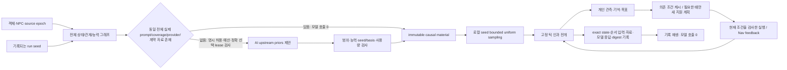

# 랜덤 비상상황 엔진: 구현과 재현 계약

이 문서는 `workers/simulator`의 소스와 오프라인 계약을 설명한다. 내부 AAA는 지정한 계약 검증의 판정명이다. 현재 전체 Unity 플레이, 모든 객체의 현장 의미, 실제 구독 NPC 추론과 이동, 현장 훈련 효과의 인증이 아니다. 비상상황은 개발자가 만든 완성 사건 목록에서 선택하지 않는다. 구현된 능력과 인과 전이 안에서 객체 상태·관계·외부 입력·참가자 개입이 결과를 만든다.

## 구현 경계

| 계층 | 실제 구현 | 근거와 제한 |
|---|---|---|
| 월드·입력 | `WorldObjectRegistry`, `WorldCoverage`, `StationCapabilityInference`, `PlatformWorldFactory` | 모든 입력 객체의 ID·관계·상태를 유지한다. 능력은 명시된 semantic assembly에만 부여한다. 추론 프로필은 `INFERRED_TRAINING`; 실제 배선·재료·문 기구는 검증된 것으로 취급하지 않는다. |
| 초기 인과 자료 | `InitialConditionMaterial`, `EmergenceComposer`, `InitialConditionMaterialStore` | AI는 최대 16개 upstream 범위 자료를 제안한다. 자료를 고정한 뒤 로컬 seed로 bounded uniform 값을 샘플한다. 경험적 물리 분포나 완성 시나리오 저장소가 아니다. |
| 사건 전개 | `CausalKernel` | 수분·전원·열·구조·통신·건강의 원자 규칙, 거리·구획·연결·자원 조건과 독립 RNG stream. CFD/FEM·탈선 동역학·임상 모델이 아니다. |
| 개인 행동 | `Community`, `PlanningCoordinator`, `PlanCache`, `PlanExecutor` | 로컬 관측·기억·반응 지연·지속 목표, 지원 조작 제안과 실행 조건 검사. 캐시는 의존 조건이 유효할 때만 재사용한다. |
| 제품 어댑터 | `PlatformSeededSimulator`와 Unity 어댑터 | FPS 입력, NavMesh, 물리 관측과 시각 표현. 실제 Unity 검증은 보류 상태이며 소스/API 검사가 그 결과를 대신하지 않는다. |

SimWorld·Virtual Community·AgenticCache는 원리를 참고한 자체 구현이다. 연구 엔진 전체를 도입한 것이 아니다. JEV 평가 adapter는 선택적 개발 기능이며 현재 제품 구독 planner에는 evaluator가 연결되지 않는다. 기본 인과 틱은 모델을 호출하지 않는다.

## 파이프라인



### 초기 생성 수도코드

```text
require stopped initial world, explicit authorization, valid selected play lease
request = all_world_graph(world, coverage)  # 누락 없이; 숫자 prompt 요약은 4자리
key = hash(applicability(world), exact_coverage, logical_provider_binding, actual_full_provider_body_sha,
           prompt_contract, material_contract, explicit_revision)
if key already has immutable material:
    read existing content; reserve/call/initial quota consumption = 0
else singleflight:
    reserve bounded input/output/request budget before transport
    obtain upstream proposal through the exact provider/account/model lease
    reject malformed/basis/seed/usage/range/capability errors before world write
    freeze sorted bounded priors with exact-f64 bounds and content SHA
check caller cancellation, current volatile lease, stopped tick0 and exact old digest again
for each prior in stable entity/property order:
    value = lower + (upper-lower) * Unit(seed, material_sha/property, tick0, entity)
    # zero-width priors retain the exact endpoint bits
validate every sampled change, then apply all changes atomically
record material + store provenance + samples + pre/post digests
```

새 외부 LLM 응답은 seed만으로 재현하지 않는다. 재현 입력에는 **고정된 자료 ID/내용**이 포함된다. 같은 자료·같은 월드 구성·같은 seed는 같은 값과 초기 상태를 만든다. 저장된 자료의 재사용은 모델을 다시 호출하지 않는다. 현재 store는 제한된 process-local ledger이며 기록에 자료를 저장한다. 다른 실행에서 자료를 쓰려면 그 기록을 명시적으로 읽어야 한다. 영구 자동 캐시가 설치됐다고 주장하지 않는다.

applicability는 전체 ID·parent·kind·능력/tag·links·state schema·정적 좌표·source/inference/catalog epoch를 고정한다. seed에 따른 NPC 위치와 upstream 수치 샘플은 제외한다. coverage와 logical provider/account/model/catalog/contract 및 **실제 provider body 전체 SHA**도 store key에 묶인다. 이 SHA는 실제 model/system prompt/messages/output limit/purpose/seed metadata를 포함하며 나중에 붙는 비밀 capability·volatile 선택 lease 헤더를 포함하지 않는다. 입력 숫자·위치·seed를 캐시 적중을 위해 삭제하거나 정규화하지 않는다. 전송에는 여전히 정확한 volatile 8-key 선택이 필요하다. token/session 갱신을 저장 자료의 원인으로 오인하지 않으며, lease가 바뀐 in-flight 응답은 적용하지 않는다.

현재 실제 모델 입력에는 seed·정확 basis·상태 수치·위치도 들어가므로, **새 seed는 새 모델 입력 key**가 된다. 자동 store 재사용의 호출 0은 동일한 실제 입력에서만 보장한다. 고정된 저장 자료를 명시적으로 선택해 로컬 seed를 다시 샘플하는 기능과 새로운 AI 질의는 다른 경로다. 저장 자료도 구조·능력·source가 달라지면 적용하지 않는다. 모든 새 seed에서 모델 호출 0이나 원격 LLM의 seed 결정성을 주장하지 않는다.

허용 목록은 17종 property다: wetness, drainage, insulation, wear, water.pressure, temperature, cooling, ventilation, fuel, load.capacity, wind.rating, medical.vulnerability, mobility.base, rain, wind, ambient.temperature, rate_multiplier. 이는 사건 종류 수가 아니다. 최대 16 priors는 입력 객체 수 제한도 아니다. 화재·고장·부상·문 상태를 직접 쓰는 제안, 객체/능력 발명, 범위·중복·비유한 값은 거부한다. 빈 제안과 평온한 실행을 허용한다. legacy exact-value proposal은 고정된 zero-width prior로 동결하며 기록 호환 경로임을 구분한다.

### 틱과 관련성 수도코드

```text
# FPS host, BEFORE the causal kernel:
apply recorded/live motion observations (pose/speed/LOS/arrival/failure)
apply ordered manual commands through the guarded executor
apply recorded/live mechanical inputs and response inputs/observations
project door/navigation feedback at the recorded call boundary

# causal kernel only:
preflight ALL fields/entities/states/positions/radii/counters before any write
objects = stable semantic assembly roots; exclude render-only/removed parts
environment = seeded regional rain/wind/ground/alert/network inputs and recession
update water/explicit power supply/isolation
heat = snapshot pair exchange with distance/height/zone/link/barrier and finite budgets
update thermal/fault/fuel/fire/smoke
update structure and communications/alarm availability
update people from local traction/density/exposure/health
increment fixed tick

# FPS host, AFTER the causal kernel:
update local perception/social-knowledge snapshot/memory/reaction/persistent goals
project door/navigation feedback again at its recorded boundary
offer only known eligible operations; reuse only valid dependency-bound plans
poll async planning admissions/replies; apply ready guarded NPC steps
flush ordered model records/transitions/observations, compute digest, write exact tick
```

발생 확률은 `p = 1-exp(-max(0,rate) × local_factor × dt × multiplier)`다. 예를 들어 단락은 전원·습기·절연·마모를, 점화는 연료·온도·수분을 요구한다. 열 교환은 같은 snapshot에서 donor loss와 receiver gain을 짝으로 계산하며 capacity/transfer budget을 적용한다. 전원 차단, 거리·구획·열 barrier와 제거가 해당 경로를 끊는다. 계수는 게임 파라미터이며 실측 철도 사고 확률이 아니다.

지원 범위는 수분·누수, 전기 고장, 제한된 열·화재·연기, 추상 구조 손상, 낙상·건강·군중 압박, 추상 moving-body 접촉, 통신 장애·민방위 경보와 대피/보호 목표다. 침수 유체, 공기 중 연기 CFD, 완전한 전시 효과, 열차 탈선/운행 제어와 임상 처치는 미구현·미검증 범위다.

## 재현과 숫자 계약

`chooguard-causal-v2` 상태 digest는 typed JSON 배열과 finite IEEE754 bit string을 해시한다. ID 구분 문자, null/string 경계, negative zero와 Mono의 double `R` 변환 손실을 구분한다. `sha256-counter-v2`는 version/seed/stream/tick/entity/draw의 typed tuple을 해시하므로 공용 순차 RNG 소비가 없다. 자료 경계도 exact-f64를 사용한다. 전체 RunHeader/Tick은 `LocalTapeCodec`의 `local-exact-json-tree-v1` typed token tree로 저장한다. motion/mechanics/response/navigation/transition 숫자도 bit를 보존하며 literal marker 문자열·객체는 일반 data node로 남긴다. 모델/provider/native 관리 JSON에는 이 형식을 사용하지 않는다.

기록용 CLR DTO의 첫 숫자 생성은 `LocalTapeCodec.FromObject/Float`를 사용한다. 설치된 Mono/Json.NET의 `JValue(double)`가 -0를 +0로 바꾸는 접점을 피하려고 boxed number를 사용하며 decoder도 같은 경계를 지킨다. float32 위치는 정확히 double로 넓혀 저장하고 DTO reader에서 float32로 되돌린다. ISO 날짜 모양의 문자열은 DateParseHandling.None으로 유지한다. 이미 손실된 JToken·과거 tape의 원래 bits를 복구한 것으로 주장하지 않는다. 실제 input/outcome/transition DTO와 host와 같은 float32·double 숫자 경로를 portable fixture로 검사하며 Unity 움직임 자체를 실행하지 않는다.

이 exact full-DTO 계약은 native FPS의 `RunHeader/Tick` tape와 내부 `planning-record-v3` recorded reply에 한정된다. `SimulatorCli`의 개발용 `kind=header` baseline JSONL은 별개 형식이며 native reader가 소비하지 않는다. CLI의 고정 fixture 재생 통과는 arbitrary external f64 입력의 exactness 인증이 아니다. 일반 모델 요청·응답 JSON에는 local tape codec을 적용하지 않는다.

전체 입력의 비유한 상태, 수치 envelope를 넘는 인과 계수·좌표·반경, tiny crowd radius, version/tick overflow와 semantic cycle은 틱의 첫 쓰기 전에 거부한다. 큰 유효 반경은 제한된 entity scan을 사용해 빈 grid cell 반복 폭증을 막는다. 초기 자료의 적용 역시 entity별 실제 변경 수를 먼저 합산해 version overflow가 없는지 검사한 뒤 쓴다. `Entity.Set`는 실수 bit 차이를 감지하고 version을 먼저 checked 계산해 signed zero를 보존한다. 이 numerical envelope는 물리 교정 결과가 아니다.

새 기록은 exact initial world, 실제 step/rate의 bit encoding, ordered inputs/관측, 자료·선택 provenance, 모델 admission/응답/apply tick 및 digest를 유지한다. native FPS step은 0.5초이고 initial rate는 0..4 범위다. header와 saved world의 설정이 다르거나 기록이 빠지면 거부한다. 자연 재생 완료는 모든 planning evidence 소비까지 검사한다. 사용자 중단은 aborted이며 완료 PASS가 아니다.

재현 tuple은 source epoch + engine/RNG/semantic/material/prompt/executor versions + seed + fixed tick/config + immutable material + ordered actions + recorded exogenous/physical observations다. 다른 행동·source·자료·dt는 다른 입력이다. Unity 재생은 기록된 물리/시야 입력을 사용하며 Unity 물리를 독립 재시뮬레이션한 것이 아니다. 과거 lossy/v1 tape는 버전을 자동 변조하거나 잃은 수치를 복구한 것처럼 통과시키지 않는다.

## 검증과 보류 경계

`InitialConditionMaterialTests`, `EmergenceGenerationTests`, `KernelTests`, `WorldStateCodecTests`는 자료 재현·범위·형식·epoch·파생 결과 거부, 관련성 개입, quiet-world, semantic dedup, 삽입 순서, 수치·해시와 offline replay를 검사한다. B lane은 store/lease/singleflight, planning replay와 예산·계산 overflow 경계를 검증한다.

C3 분포 시험은 seed 1..4096, 사전 9개 `(rate,dt,multiplier)` 조합과 family alpha .001의 Hoeffding 임계값을 고정한다. TestU01이나 현장 확률 검증을 대체하지 않는다. 별도 constant-source cooling fixture는 dt=1/.5/.125, 동일 4초에서 Euler 수치 민감도를 분석해 공개한다. 다른 dt의 bit-identical trajectory를 요구하지 않는다.

현재 5,105-state pure 검증은 **과거 tape에서 읽은 parsed baseline**을 새 exact codec로 보존하고, 동일 자료/seed/ordered inputs로 20 causal ticks를 비교한다. 원래 native 메모리의 잃은 bits를 회복하거나 전체 Unity replay 실패를 해결한 증거가 아니다.

동결 epoch의 saved objects 4,115 / active 3,844 / physical eligible 2,748과 state 5,105는 다른 분모다. 5,105 = source 4,115 + baseline 532 + inferred 396 + station places 52 + tools/team 10. unknown 2,400은 그대로 남는다. 최신 원본 scene hash는 동결 `ec2f...`와 달라졌으며 이번 작업은 새 Unity snapshot을 작성하지 않는다. 실제 whole-world play/replay의 실패, 장소·문·모든 층의 기능과 현장 의미, 원본 통합·한글 폰트·UI 렌더·실구독 NPC 이동은 별도 FAIL/UNVERIFIED/PENDING으로 유지한다. 상세 현장 조작·매뉴얼 대응은 사용자 지시로 후순위다.

최종 판정은 task-scoped rubric, 변경 후 hash receipt와 독립 review를 참조한다. 테스트 결과를 보지 않고 이 문서만으로 AAA를 주장하지 않는다.

### 수치 envelope와 시험용 높은 rate

일반 world/known causal coefficients는 절댓값 1e6, dt는 (0,60], multiplier는 [0,1e6], 좌표는 1e9, local radius는 [0,1000], NPC crowd radius는 [.001,1000] 범위를 계약으로 선언한다. Metadata hash word는 causal coefficient가 아니며 별도로 보존한다. rate.*는 절댓값 1e100까지 별도의 finite envelope를 사용한다. 기존 station supply counterfactual의 rate.electrical-short=1e9는 빠른 발생을 위한 stress fixture이며 AI의 17-property 목록은 rate.*를 직접 수정하지 못한다. 제품 initial multiplier는 0..4다. 테스트 rate·시간·개입 조건을 낮춰 통과시키지 않았다.

수치 안전성: 입력 entity 수는 .NET dictionary의 int Count 이내다. 최소 crowd 반경 .001이면 density<=Int32.MaxValue/(π·.001²)<7e14. fall의 local factor `(surfaceRisk+.05*pressure)*speed`는 known coefficient 1e6 조건에서 4e19 미만이며, 다른 rate factor는 그보다 작다. 따라서 rate×factor×dt×multiplier < 1e100·4e19·60·1e6 = 2.4e127로 double overflow보다 작다. exp(-large positive)는 0에 수렴해 probability가 1로 안전하게 포화된다. 이는 생리·물리적으로 허용되는 rate의 교정이 아니라 수치 표현의 envelope다. 기존 generic 1e6 rate 제한을 추가해 stress fixture가 막힌 실패 packet은 계획 폴더에 남긴다.

UTF8 기반 입력 예약 단위와 provider가 실제 보고한 tokenizer tokens/quota는 구분한다. 컨텍스트를 줄여 숨기지 않고 사전 budget 초과를 거부한다. 실제 사용량이 예약을 초과하면 회로를 닫지만, 이 휴리스틱은 외부 청구액의 절대 상한이나 공식 tokenizer 추정의 증명이 아니다. 누락된 사용량은 예약분으로 보수적으로 처리한다. 제품은 developer API billing으로 전환하지 않는다.
