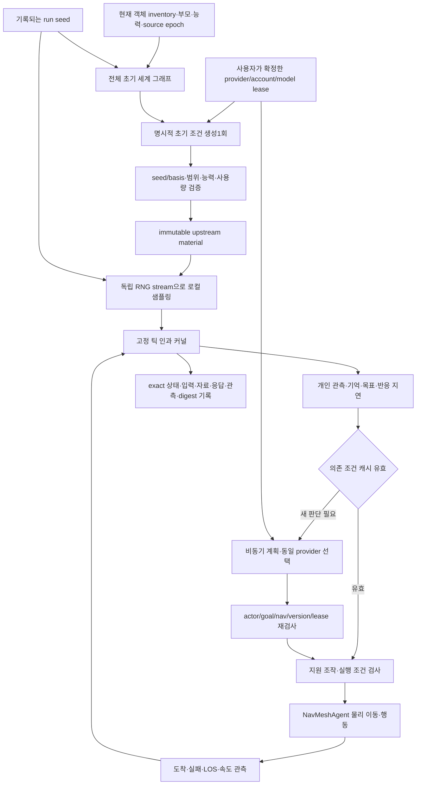

# 비상 인과·개인 계획·물리 실행 아키텍처

이 문서는 [승인 방향 인계](PLAN.md)를 구체화한다. 근거는 기존 `workers/simulator/Runtime` 및 [인과 계약](../EMERGENCY_CAUSAL_ARCHITECTURE.md)이다. PR에는 문서만 포함하며 Unity 설치 상태를 주장하지 않는다.

| 계층 | 기존 소스 | 역할과 경계 |
| --- | --- | --- |
| 입력·의미 | WorldObjectRegistry / WorldCoverage / StationCapabilityInference / PlatformWorldFactory | 전체 ID·부모·관계·상태를 유지한다. render-only 객체를 독립 위험체로 오인하지 않는다. 추론 능력은 INFERRED_TRAINING으로 구분한다. |
| 초기 조건 | EmergenceComposer / InitialConditionMaterial / InitialConditionMaterialStore | 모델은 최대16개의 허용된 upstream prior 범위를 제안한다. 화재/부상/고장 같은 결과나 새 객체/능력/완성 사건을 직접 넣지 못한다. 빈 제안과 평온한 실행도 유효하다. |
| 시간 전개 | CausalKernel | 수분·전원·열·구조·건강 등의 구현된 원자 전이가 현재 상태/근접/구획/공급/자원 조건에 따라 전개된다. 임의의 실제 물리현상을 자동 지원하는 모델이 아니다. |
| 개인 행동 | Community | 보이는 것과 이전 지식/기억을 사용한다. 위험을 관측한 뒤 반응 지연을 거쳐 지원·대피·보호 또는 평시 목적지를 선택한다. 도착/실패/관측 위험 변화 전까지 목표를 유지한다. |
| 계획 | PlanningCoordinator / PlanCache | 의존 조건과 actor/goal/nav/contract에 묶인 캐시, 비동기 요청 합치기, cooldown·예산·동시성 제한을 사용한다. 외부 응답이 늦으면 현재 조건을 다시 검사한다. |
| 실행 | PlanExecutor / OperationCatalog | 알려진 지원 조작만 실행하며 대상·능력·범위·순서·자원 등 현재 전제조건을 검사한다. 모델 문자열을 임의 명령으로 실행하지 않는다. |
| 이동 | PlatformNavigation / SeededNpcController | NavMeshAgent만 물리 위치/속도를 소유한다. 같은 이동 표면과 PathComplete를 확인한다. 도달 불가를 피드백하고 벽 통과/순간이동으로 성공 처리하지 않는다. |
| 기록 | WorldStateCodec / LocalTapeCodec / replay | 수락한 외부 출력과 실제 입력/이동 관측을 기록한다. 재생은 모델 호출 없이 기록을 소비하며 Unity 물리의 독립 재현이나 현장 타당성 인증과 구분한다. |

## 데이터·계정 경계

초기 세계 입력은 전체 객체·부모·관계·상태·시각 매핑을 복원 가능한 형식으로 압축한다. 입력 한도를 맞추기 위해 객체를 몰래 제거하지 않는다. 입력 예약 단위는 보수적인 UTF8 기반 추정치이며 공급사가 보고한 실제 tokenizer tokens와 구분한다.

현재 로컬 통합에서 전체 입력 약766KB가 과거192000/256000 예약 한도를 넘었다. 다음 구현은 초기1회 최대1MiB 예약 단위와 요청 출력512토큰이라는 조정 방향을 반영하되, 일반 NPC 계획 예산(기본12요청/12000입력 예약/3000출력)과 분리한다. 이 PR은 해당 코드 변경을 전달하지 않는다. 서버·클라이언트·UI·본문 크기 제한을 일치시켜야 한다.

provider/account/model/catalog/contract의 logical binding과 실제 요청 body SHA를 자료 key에 포함한다. 전송은 현재 volatile selection lease를 요구한다. 선택이 바뀐 in-flight 응답은 적용하지 않는다. 같은 정확 입력의 캐시 적중과 새 seed에서 저장 자료를 명시적으로 재샘플링하는 경로를 구분한다. 계정 토큰·로컬 capability는 자료나 Git에 포함하지 않는다.

## 연구를 적용하는 수준

[기존 연구 정리](../../RESEARCH.md)의 SimWorld는 상태/목표/행동/실행 피드백 분리에, Virtual Community는 공간에 연결한 개인 관측/기억/사회 정보에, AgenticCache는 의존 조건이 유효한 계획 재사용과 비동기 갱신에 대응한다. 연구의 효과 수치나 ORCA 구현·전층 이동 완료를 이 설계의 성과로 주장하지 않는다.
